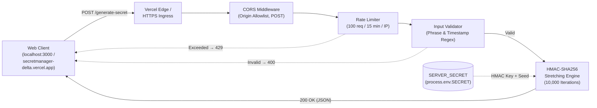

# SecretManager Server

[](./LICENSE)
[](./src/package.json)
[](./src/vercel.json)
[](https://www.conventionalcommits.org/)

A stateless, zero-persistence Express.js API that derives **deterministic cryptographic secrets** from a user-supplied passphrase, a 13-digit Unix millisecond timestamp, and a confidential server-side pepper (`SECRET`) using **10,000 rounds of HMAC-SHA256 hash stretching**.

Because secrets are deterministically recomputed on demand rather than stored in a database, there is no credential vault to breach or synchronize.

---

## ⚡ Quick Start

Boot the local server in 3 steps:

```bash
# 1. Clone the repository and enter the application directory
git clone https://github.com/digitalterrene/secretmanager-server.git
cd secretmanager-server/src

# 2. Configure environment variables
cp example.env .env
# Edit .env and set a strong, constant SECRET value and PORT (default: 4000)

# 3. Install dependencies and start the server
npm install
node index.js
```

Verify the server is deriving secrets:

```bash
curl -X POST http://localhost:4000/generate-secret \
  -H "Content-Type: application/json" \
  -d '{"phrase": "b@Sesfhgjk1", "timestamp": "1731255347375"}'
```

> [!NOTE]
> `src/package.json` defines `"start": "nodemon /index.js"`. On Linux/macOS/Windows, use `node index.js` or `npx nodemon index.js` from inside `src/` if the leading slash resolves to filesystem root on your OS.

---

## 🏗️ System Architecture



### Documentation Architecture (4-Tier Hierarchy)

| Tier | Document | Purpose |
|---|---|---|
| **Tier 1: Governance** | [CONTRIBUTING.md](./CONTRIBUTING.md) · [SECURITY.md](./SECURITY.md) · [docs/git-standards.md](./docs/git-standards.md) | Onboarding, branching, Conventional Commits, vulnerability reporting |
| **Tier 2: Architecture** | [System Design](./docs/architecture/system-design.md) · [Data Model & API Contracts](./docs/architecture/data-model.md) · [Security Architecture](./docs/architecture/security-and-rbac.md) | Component topology, sequence diagrams, DTO contracts, threat model |
| **Tier 3: Decisions** | [ADR Index](./docs/adr/README.md) ([ADR-001](./docs/adr/ADR-001-stateless-deterministic-secret-derivation.md), [ADR-002](./docs/adr/ADR-002-hmac-sha256-hash-stretching.md), [ADR-003](./docs/adr/ADR-003-vercel-serverless-express-deployment.md)) | Immutable records of architectural trade-offs |
| **Tier 4: Runbooks** | [Deployment Verification](./docs/runbooks/deployment-verification.md) · [Incident Response](./docs/runbooks/incident-response.md) | Copy-paste smoke tests, Vercel deployment checks, triage flowcharts |

---

## 📡 API Reference

### `POST /generate-secret`

Derives a deterministic 64-character hexadecimal secret from `phrase`, `timestamp`, and the server-side `SECRET`.

#### Request Body (`application/json`)

| Field | Type | Required | Validation Rules |
|---|---|---|---|
| `phrase` | `string` | Yes | Minimum 6 characters; at least one letter (`a-zA-Z`), one digit (`0-9`), and one special character from `@$!%*?&`; only characters in `[A-Za-z\d@$!%*?&]` |
| `timestamp` | `string` | Yes | Exactly 13 numeric digits (`^\d{13}$`), representing a Unix timestamp in milliseconds |

#### Responses

- **`200 OK`** — Deterministic secret generated:
  ```json
  {
    "secret": "3fcf2bbfa2c60222039de129fb0d50968844f35114ad16eb40be68c19fdfdcaf",
    "phrase": "b@Sesfhgjk1",
    "timestamp": "1731255347375"
  }
  ```
- **`400 Bad Request`** — Validation failure:
  ```json
  {
    "error": "Invalid passphrase. It must contain at least one letter, one number, and one special character, and be at least 6 characters long."
  }
  ```
  or
  ```json
  {
    "error": "Invalid timestamp. It should be a 13-digit Unix timestamp."
  }
  ```
- **`429 Too Many Requests`** — Rate limit exceeded (100 requests per 15-minute window per IP):
  ```text
  Too many requests, please try again later.
  ```

### `POST /`

Basic server liveness response registered on startup:

- **`200 OK`**: `Server running on port <PORT>`

---

## 🛠️ Tech Stack & Repository Structure

| Layer | Technology | Role |
|---|---|---|
| Runtime | Node.js (CommonJS) | Server runtime |
| HTTP Framework | Express `^4.21.1` | Routing and JSON middleware |
| Cryptography | Node.js `crypto` (HMAC-SHA256) | 10,000-round deterministic hash stretching |
| Access Control | `cors` `^2.8.5` | Strict origin allowlist (`POST` only) |
| Abuse Protection | `express-rate-limit` `^7.4.1` | IP-based fixed-window throttling (100 req / 15 min) |
| Configuration | `dotenv` `^16.4.5` | Local `.env` loading |
| Hosting | Vercel (`@vercel/node`) | Serverless production deployment |

```text
secretmanager-server/
├── .github/
│   ├── ISSUE_TEMPLATE/
│   │   ├── bug_report.md
│   │   └── feature_request.md
│   └── PULL_REQUEST_TEMPLATE.md
├── docs/
│   ├── adr/                          # Tier 3: Architecture Decision Records
│   │   ├── README.md
│   │   ├── ADR-000-template.md
│   │   ├── ADR-001-stateless-deterministic-secret-derivation.md
│   │   ├── ADR-002-hmac-sha256-hash-stretching.md
│   │   └── ADR-003-vercel-serverless-express-deployment.md
│   ├── architecture/                 # Tier 2: System & Security Specifications
│   │   ├── system-design.md
│   │   ├── data-model.md
│   │   └── security-and-rbac.md
│   ├── runbooks/                     # Tier 4: Operational & Triage Runbooks
│   │   ├── deployment-verification.md
│   │   └── incident-response.md
│   └── git-standards.md              # Tier 1: Git & Commit Non-Negotiables
├── src/
│   ├── example.env                   # Environment variable schema
│   ├── index.js                      # Express application & crypto engine
│   ├── package.json                  # Dependencies & scripts
│   ├── package-lock.json             # Locked dependency graph
│   ├── README.md                     # Pointer to root documentation
│   └── vercel.json                   # Vercel serverless routing config
├── .gitignore                        # Hardened secret & artifact exclusions
├── CONTRIBUTING.md                   # Contribution workflow & standards
├── LICENSE                           # MIT License
├── README.md                         # This document
└── SECURITY.md                       # Responsible disclosure & SLAs
```

---

## ⚙️ Environment Configuration

Copy [`src/example.env`](./src/example.env) to `src/.env` for local development. In production, configure these in your Vercel project settings.

| Variable | Description | Required | Default |
|---|---|---|---|
| `SECRET` | Server-side pepper and HMAC-SHA256 key. **Must remain constant** — changing it alters every derived secret. | Yes | None |
| `PORT` | TCP port for local Express HTTP listener | Yes (local) | `4000` (in `example.env`) |

> [!WARNING]
> **Never commit `.env` files or production `SECRET` values to version control.** Losing or rotating `SECRET` permanently changes all deterministic outputs for every user.

---

## 🧪 Verification & Hygiene Audits

Run the repository hygiene audit from the repository root:

```bash
node .agents/skills/senior-repo-standards/scripts/audit-hygiene.js
```

For full endpoint smoke tests, determinism checks, CORS preflight checks, and rate-limit verification, follow the [Deployment Verification Runbook](./docs/runbooks/deployment-verification.md).

---

## 🤝 Contributing

We welcome contributions. Please review [CONTRIBUTING.md](./CONTRIBUTING.md) and [docs/git-standards.md](./docs/git-standards.md) before opening a Pull Request.

---

## 🛡️ Security

To report security vulnerabilities responsibly, review [SECURITY.md](./SECURITY.md). For the cryptographic threat model and hardening checklist, see [docs/architecture/security-and-rbac.md](./docs/architecture/security-and-rbac.md).

---

## 📄 License

This repository is licensed under the [MIT License](./LICENSE).
