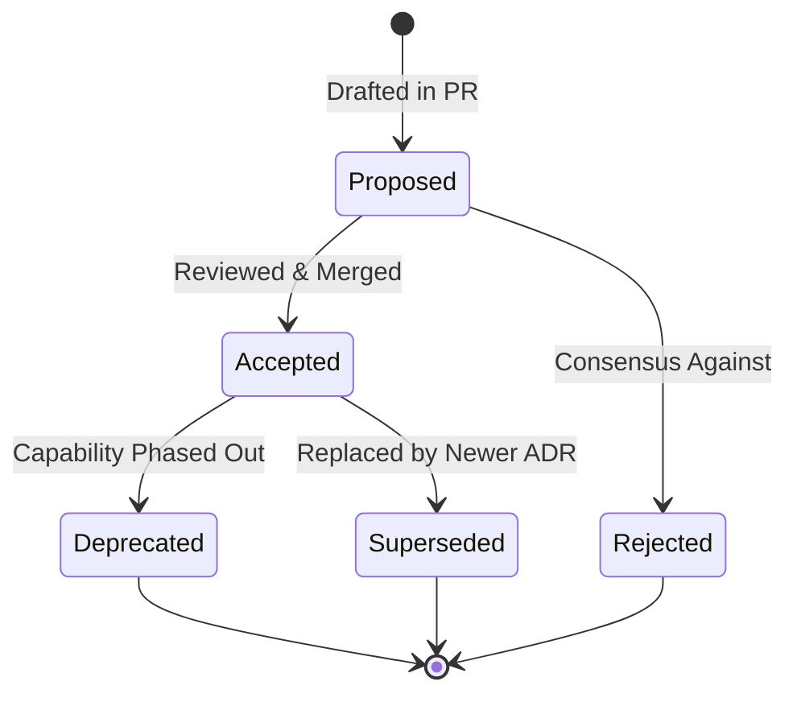

# Architecture Decision Records (ADRs)

This directory contains immutable records of architecturally significant decisions made for **SecretManager Server**. Each ADR documents the context, decision, trade-offs, and rejected alternatives so future engineers and AI agents understand *why* the system is built the way it is.

---

## ADR Index

| ADR | Title | Status | Date |
|---|---|---|---|
| [ADR-000](./ADR-000-template.md) | Architecture Decision Record Template | Template | 2026-11-22 |
| [ADR-001](./ADR-001-stateless-deterministic-secret-derivation.md) | Stateless Deterministic Secret Derivation (Zero-Persistence Model) | Accepted | 2026-11-22 |
| [ADR-002](./ADR-002-hmac-sha256-hash-stretching.md) | 10,000-Round HMAC-SHA256 Hash Stretching for Secret Generation | Accepted | 2026-11-22 |
| [ADR-003](./ADR-003-vercel-serverless-express-deployment.md) | Serverless Express Deployment on Vercel (`@vercel/node`) | Accepted | 2026-11-22 |

---

## ADR Lifecycle

### Rules
- **Never rewrite an Accepted ADR's decision.** If requirements evolve (for example, migrating from HMAC-SHA256 to Argon2id), create a new ADR (e.g., `ADR-004`) and mark the prior ADR as `Superseded by ADR-004`.
- **Use [`ADR-000-template.md`](./ADR-000-template.md)** when proposing new architectural changes.
