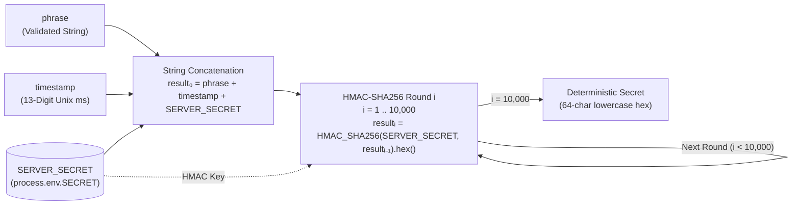
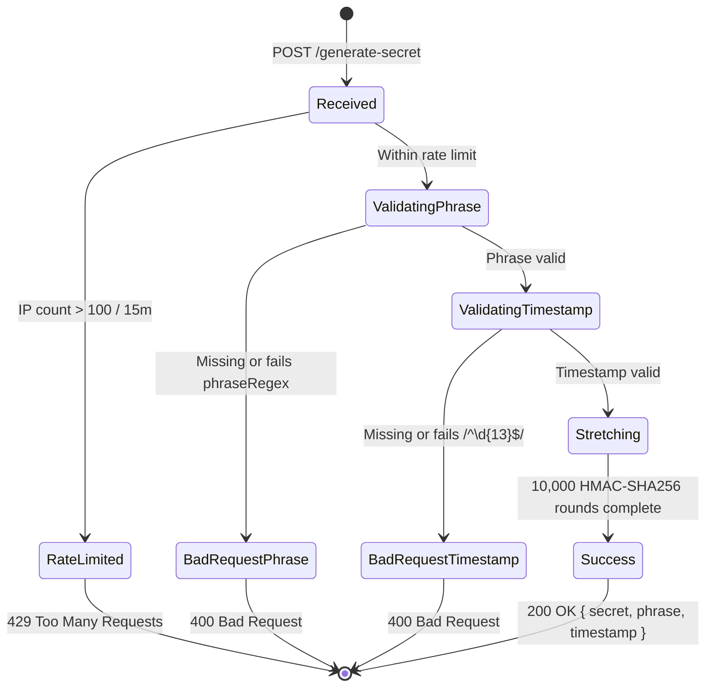

# Data Model, API Contracts & Cryptographic Pipeline

- **Status**: Living Architecture Specification
- **Last Updated**: 2026-11-22
- **Primary Implementation**: [`src/index.js`](../../src/index.js)

---

## 1. Persistence Model: Stateless / Zero-Storage

**SecretManager Server** intentionally maintains **no database, no user table, and no persistent state**. All domain "entities" are ephemeral request/response Data Transfer Objects (DTOs) and in-memory cryptographic state that exist only for the duration of a single HTTP request.

The only stateful component at runtime is the ephemeral IP request counter maintained in memory by `express-rate-limit` (15-minute sliding/fixed window per IP).

---

## 2. Cryptographic Derivation Pipeline

The core domain transformation maps `(phrase, timestamp, SERVER_SECRET)` deterministically to a 256-bit hexadecimal digest:



### Mathematical Specification

Let:
- $P$ = validated `phrase` (UTF-8 string)
- $T$ = validated `timestamp` (13-character ASCII digit string)
- $K$ = `SERVER_SECRET` (`String(process.env.SECRET)`)
- $N$ = `STRETCH_COUNT` = `10000`

Then:
$$R_0 = P \parallel T \parallel K$$
$$R_i = \operatorname{hex}\big(\operatorname{HMAC\text{-}SHA256}(K,\; R_{i-1})\big) \quad \text{for } i = 1, 2, \dots, N$$
$$\text{secret} = R_{10000}$$

### Determinism Invariants
1. **Identical Inputs → Identical Output**: Given the same `(phrase, timestamp)` and the same `SERVER_SECRET`, `generateDeterministicSecret` will always return the exact same 64-character hex string across restarts, hosts, and Node.js versions.
2. **Avalanche Effect**: Changing a single character in `phrase`, a single digit in `timestamp`, or any byte of `SERVER_SECRET` produces a cryptographically unrelated 256-bit output.
3. **Key Immutability**: `SERVER_SECRET` is a permanent dependency of every derived secret. Rotating `SECRET` invalidates all previously generated secrets.

---

## 3. Input Validation & Response State Machine



---

## 4. API Data Transfer Objects (DTOs)

### `GenerateSecretRequest` (`POST /generate-secret`)

```json
{
  "phrase": "b@Sesfhgjk1",
  "timestamp": "1731255347375"
}
```

| Field | Type | Required | Regex / Constraint | Notes |
|---|---|---|---|---|
| `phrase` | `string` | Yes | `/^(?=.*[a-zA-Z])(?=.*\d)(?=.*[@$!%*?&])[A-Za-z\d@$!%*?&]{6,}$/` | Minimum 6 chars; ≥1 ASCII letter, ≥1 digit, ≥1 special char in `@$!%*?&`; rejects spaces and characters outside the allowlist. |
| `timestamp` | `string` | Yes | `/^\d{13}$/` | Must be a 13-digit string representing Unix epoch milliseconds (e.g., `Date.now().toString()`). |

### `GenerateSecretResponse` (`200 OK`)

```json
{
  "secret": "3fcf2bbfa2c60222039de129fb0d50968844f35114ad16eb40be68c19fdfdcaf",
  "phrase": "b@Sesfhgjk1",
  "timestamp": "1731255347375"
}
```

| Field | Type | Format | Description |
|---|---|---|---|
| `secret` | `string` | `^[0-9a-f]{64}$` | 256-bit HMAC-SHA256 stretched digest encoded as lowercase hex. |
| `phrase` | `string` | Echoed input | Original validated passphrase returned for client-side display/binding. |
| `timestamp` | `string` | Echoed input | Original 13-digit timestamp returned so client can pair/remember the salt. |

### `ErrorResponse` (`400 Bad Request`)

```json
{
  "error": "Invalid passphrase. It must contain at least one letter, one number, and one special character, and be at least 6 characters long."
}
```

---

## 5. Complete Error Catalog

| HTTP Status | Content-Type | Trigger Condition | Exact Payload |
|---|---|---|---|
| `400` | `application/json` | `phrase` is falsy or fails `phraseRegex` | `{"error": "Invalid passphrase. It must contain at least one letter, one number, and one special character, and be at least 6 characters long."}` |
| `400` | `application/json` | `timestamp` is falsy or fails `/^\d{13}$/` | `{"error": "Invalid timestamp. It should be a 13-digit Unix timestamp."}` |
| `429` | `text/plain` | Client IP exceeds 100 requests in 15 minutes | `Too many requests, please try again later.` |
| `400` | `text/html` (Express default) | Malformed JSON body sent with `Content-Type: application/json` | Express `body-parser` syntax error response |
