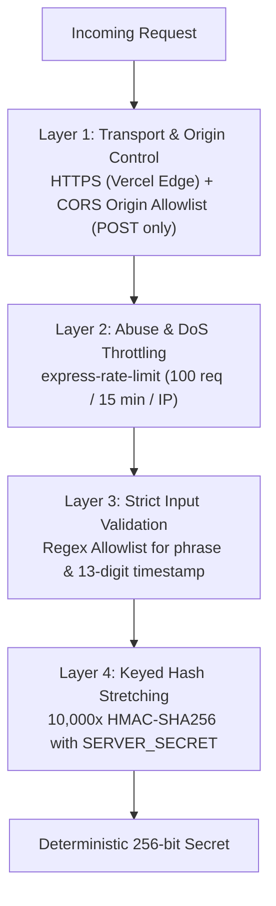

# Security Architecture, Access Control & Threat Model

- **Status**: Living Architecture Specification
- **Last Updated**: 2026-11-22
- **Primary Implementation**: [`src/index.js`](../../src/index.js) · [`SECURITY.md`](../../SECURITY.md)

---

## 1. Security Philosophy

**SecretManager Server** reduces its attack surface by eliminating persistent storage altogether. There is no database to dump, no password table to crack offline, and no session store to hijack. Security relies on **four concentric defense-in-depth layers** and strict confidentiality of the server-side `SECRET`.

---

## 2. Access Control Model (Origin & Rate-Based)

This service does not implement user accounts, JWT sessions, or Role-Based Access Control (RBAC). Instead, access is governed by **origin pinning** and **IP throttling**:

| Control | Policy | Scope |
|---|---|---|
| **CORS Allowed Origins** | `http://localhost:3000`, `https://secretmanager-delta.vercel.app` | Browser-enforced cross-origin restriction |
| **CORS Allowed Methods** | `POST` only (`optionsSuccessStatus: 200`, `preflightContinue: false`) | Prevents unintended `GET`/`PUT`/`DELETE` cross-origin calls |
| **IP Rate Limit** | `100` requests per `15 minutes` (`900,000 ms`) per IP | Applies globally to all routes via `app.use(limiter)` |

> [!IMPORTANT]
> **CORS is a browser security boundary, not an API authentication mechanism.** Non-browser HTTP clients (`curl`, server-to-server scripts) do not enforce CORS. Rate limiting and the confidentiality of `SERVER_SECRET` are the primary server-side controls against automated abuse.

---

## 3. Secrets Management (`SERVER_SECRET`)

`SERVER_SECRET` (`process.env.SECRET`) serves as both:
1. Part of the initial seed (`${phrase}${timestamp}${SERVER_SECRET}`), and
2. The HMAC-SHA256 key across all 10,000 stretching iterations.

### Secret Hygiene Rules
- **Local Development**: Stored exclusively in `src/.env` (excluded via `.gitignore`). Never put real secrets in `src/example.env`.
- **Production (Vercel)**: Stored in Vercel encrypted Environment Variables (Production scope only; use a separate non-production value for Preview/Development).
- **Backup & Immutability**: Because `SERVER_SECRET` is required to reproduce every user's historical secrets, store an encrypted offline backup in an enterprise secret vault (e.g., 1Password / AWS Secrets Manager / Bitwarden). Losing `SERVER_SECRET` permanently breaks reproducibility.

---

## 4. STRIDE Threat Model

| Threat Category | Scenario | Current Mitigation | Residual Risk & Recommended Hardening |
|---|---|---|---|
| **Spoofing** | Unauthorized frontend domain invokes the API | CORS allowlist restricts browser origins to `localhost:3000` and `secretmanager-delta.vercel.app` | Non-browser clients bypass CORS. Add API key / signed client attestation or Turnstile if abuse occurs. |
| **Tampering** | Man-in-the-middle modifies `phrase` or `secret` in transit | Vercel enforces HTTPS/TLS in production | Local dev uses HTTP; never use production `SECRET` locally. |
| **Repudiation** | Malicious actor probes passphrases without attribution | IP-based rate limiting slows probing | Add structured request logging (excluding `phrase` and `secret`!) for anomaly detection. |
| **Information Disclosure** | `phrase` echoed in `200 OK` JSON response or logged by proxies; `process.env.SECRET` accidentally undefined | Zero-persistence (nothing written to disk/DB) | **High Priority**: Add startup guard (`if (!process.env.SECRET) process.exit(1)`) so `SERVER_SECRET` can never silently become `"undefined"`. Re-evaluate whether `phrase` must be echoed in the response body. |
| **Denial of Service** | Attacker floods `/generate-secret` to exhaust CPU via 10,000 HMAC loops | `express-rate-limit` caps each IP at 100 req / 15 min | In-memory limiter resets on Vercel cold starts and per-instance. Migrate to Redis-backed rate limiting + Vercel Edge Firewall. Also enforce `phrase` maximum length (e.g., 128 chars) to bound regex & hashing cost. |
| **Elevation of Privilege** | Compromised npm dependency executes arbitrary code | Locked `src/package-lock.json` | Prune unused packages (`argon2`, `speakeasy`, `crypto` npm stub) and run `npm audit` in CI. |

---

## 5. Production Hardening Checklist

Recommended next engineering steps (track via ADRs and PRs):

- [ ] **Startup Secret Assertion**: Fail fast on boot if `process.env.SECRET` is missing or shorter than 32 bytes.
- [ ] **HTTP Security Headers**: Add `helmet` middleware (`X-Content-Type-Options`, `Strict-Transport-Security`, `Cache-Control: no-store`).
- [ ] **Cache Prevention**: Set `Cache-Control: no-store, no-cache, must-revalidate` and `Pragma: no-cache` on `/generate-secret` responses so intermediaries never cache derived secrets.
- [ ] **Maximum Input Length**: Cap `phrase` length (e.g., `6`–`128` characters) in `validateInputs()` to prevent oversized payload hashing.
- [ ] **Distributed Rate Limiting**: Back `express-rate-limit` with Upstash Redis for cross-instance consistency on Vercel.
- [ ] **Memory-Hard KDF Evaluation**: Evaluate migrating to `argon2id` (see [ADR-002](../adr/ADR-002-hmac-sha256-hash-stretching.md)) via a versioned endpoint (`/v2/generate-secret`) to preserve backwards compatibility.
