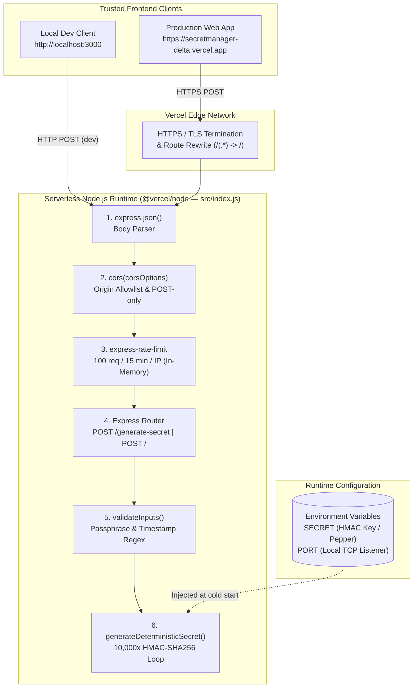
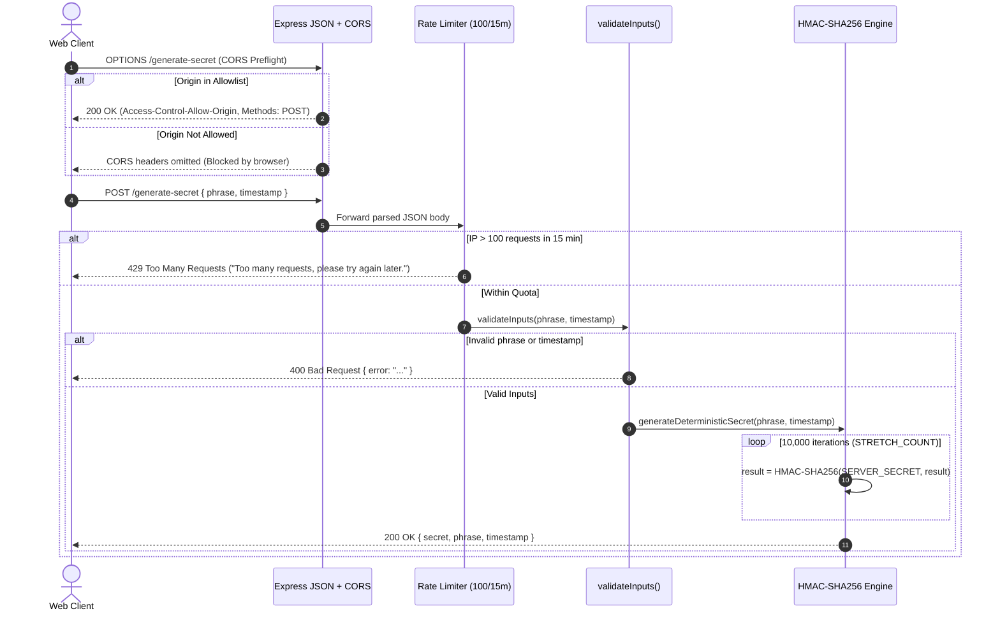

# System Design & Component Topology

- **Status**: Living Architecture Specification
- **Last Updated**: 2026-11-22
- **Primary Implementation**: [`src/index.js`](../../src/index.js) · [`src/vercel.json`](../../src/vercel.json)

---

## 1. Architectural Overview

**SecretManager Server** is a **stateless, zero-persistence cryptographic derivation API** built on Node.js and Express.js. Rather than storing encrypted user secrets in a database, the service computes a deterministic 256-bit (64-character hex) secret on demand from three inputs:

1. A user-memorized **passphrase** (`phrase`)
2. A client-supplied **13-digit Unix millisecond timestamp** (`timestamp`)
3. A confidential, immutable **server-side pepper** (`SERVER_SECRET` from `process.env.SECRET`)

Because no user records, vaults, or derived outputs are persisted, the system has a minimal infrastructure footprint and deploys cleanly as a single serverless function on Vercel (`@vercel/node`) or as a standalone Node.js HTTP server.

---

## 2. System & Deployment Topology

---

## 3. End-to-End Request Lifecycle

The following sequence diagram traces a `POST /generate-secret` request through every middleware layer and branching error path:

---

## 4. Middleware Execution Pipeline

Order matters in Express. [`src/index.js`](../../src/index.js) registers middleware in the following exact sequence:

| Stage | Middleware / Handler | Configuration | Responsibility |
|---|---|---|---|
| **1** | `express.json()` | Default (`100kb` body limit) | Parses `application/json` payloads into `req.body`. |
| **2** | `cors(corsOptions)` | Origins: `http://localhost:3000`, `https://secretmanager-delta.vercel.app`; Methods: `POST`; `optionsSuccessStatus: 200` | Enforces browser cross-origin access boundaries before rate-limit accounting or route execution. |
| **3** | `rateLimit(limiter)` | `windowMs: 900000` (15m), `max: 100` per IP | Mitigates online brute-force and CPU exhaustion (since each request executes 10,000 HMAC iterations). |
| **4** | `POST /generate-secret` | Inline route handler | Runs `validateInputs()`, computes `generateDeterministicSecret()`, returns `{ secret, phrase, timestamp }`. |
| **5** | `POST /` | Registered inside `app.listen()` callback | Basic liveness message (`Server running on port ${PORT}`). |

---

## 5. Deployment Models

### A. Production (Vercel Serverless)
Configured via [`src/vercel.json`](../../src/vercel.json):
- **Builder**: `@vercel/node` builds `*.js` files in `src/`.
- **Routing**: Catch-all rewrite `{ "src": "/(.*)", "dest": "/" }` forwards all paths to the Express app entrypoint.
- **Environment**: `SECRET` is injected via Vercel Project Environment Variables (never stored in the repository).

### B. Local Development
- Uses `dotenv` (`require("dotenv").configDotenv()`) to load `SECRET` and `PORT` from `src/.env`.
- Listens on `process.env.PORT` (conventionally `4000` per `src/example.env`).

---

## 6. Scalability, Constraints & Technical Debt

| Area | Current Behavior | Architectural Trade-off / Evolution Path |
|---|---|---|
| **CPU-Bound Derivation** | 10,000 synchronous HMAC-SHA256 iterations run on the Node.js event loop per request. | Fast enough for low-to-moderate traffic (~10–25ms/req), but concurrent bursts can block the single-threaded event loop. Consider Worker Threads or offloading if QPS scales. |
| **In-Memory Rate Limiter** | `express-rate-limit` uses its default in-memory `MemoryStore`. | Resets on every Vercel serverless cold start and is not shared across concurrent lambda instances. Upgrade to a distributed store (e.g., Upstash Redis) for strict multi-instance enforcement. |
| **Unused Dependencies** | `argon2`, `speakeasy`, and npm `crypto` stub exist in `src/package.json` but are not imported in `src/index.js`. | Indicates planned/exploratory KDF or TOTP features. Either prune unused packages to reduce attack surface or implement via a formal ADR. |
| **Start Script Path** | `src/package.json` has `"start": "nodemon /index.js"`. | Leading `/` resolves to root directory on POSIX systems; should be `"nodemon index.js"` in a future maintenance PR. |
| **Serverless Export** | `src/index.js` calls `app.listen(PORT, ...)` without `module.exports = app`. | Exporting `app` (and guarding `app.listen` for local execution) improves both Vercel serverless compatibility and automated `supertest` integration testing. |
