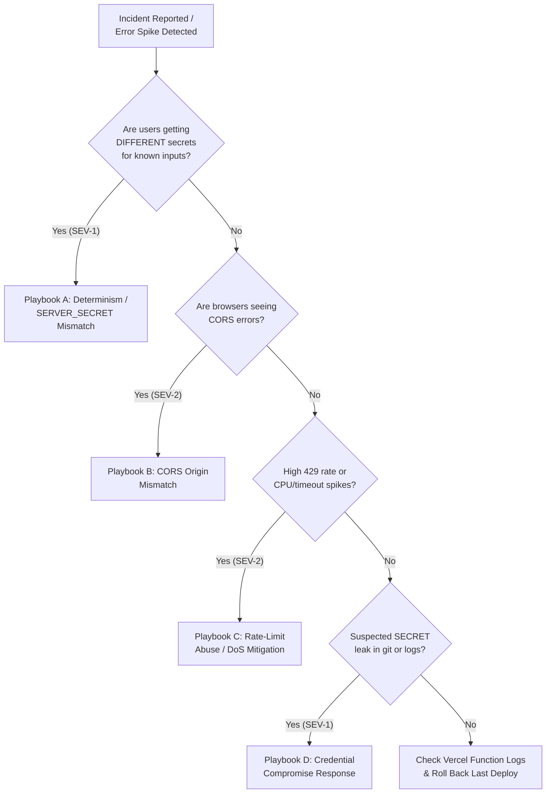

# Incident Response & Triage Runbook

- **Audience**: Maintainers, SREs, On-Call Engineers
- **Scope**: Production outages, cryptographic determinism regressions, CORS failures, abuse spikes, and `SERVER_SECRET` exposure
- **Last Updated**: 2026-11-22

---

## 1. Incident Triage Flowchart

---

## 2. Severity Levels

| Severity | Definition | Target Initial Response |
|---|---|---|
| **SEV-1 (Critical)** | `SERVER_SECRET` leaked, `process.env.SECRET` undefined in production, or determinism broken across users | Immediate (< 30 min) |
| **SEV-2 (High)** | Production endpoint down (5xx), CORS blocking `secretmanager-delta.vercel.app`, or active DoS/abuse | < 2 hours |
| **SEV-3 (Medium)** | Local dev breakage, non-critical validation bug, or single-IP false-positive rate limiting | Next business day |

---

## 3. Incident Playbooks

### Playbook A: Determinism Regression (Different Secrets Returned)
**Symptoms**: Users report that a previously known `(phrase, timestamp)` pair produces a different 64-char secret.

1. **Check Vercel Environment Variables**: Verify `SECRET` has not been accidentally edited, deleted, or overwritten with whitespace/quotes.
2. **Check `src/index.js` Diff**: Inspect recent commits for changes to `STRETCH_COUNT`, `SERVER_SECRET` formatting, or `generateDeterministicSecret()`.
3. **Immediate Mitigation**: Restore the exact prior `SECRET` value from the encrypted offline backup vault and/or roll back the Vercel deployment immediately.
4. **Verify**: Run Test 1 from [`deployment-verification.md`](./deployment-verification.md) with a known test vector.

---

### Playbook B: CORS Blocking Frontend Requests
**Symptoms**: Browser console shows `Access to fetch at '...' from origin '...' has been blocked by CORS policy`.

1. Inspect `corsOptions.origin` in [`src/index.js`](../../src/index.js) (currently `http://localhost:3000` and `https://secretmanager-delta.vercel.app`).
2. Confirm protocol (`http` vs `https`) and absence of trailing slashes in the origin string.
3. Verify using the `OPTIONS` preflight `curl` command in [`deployment-verification.md`](./deployment-verification.md).
4. Submit a `fix(cors): ...` PR updating `corsOptions.origin` and redeploy.

---

### Playbook C: Abuse Spike / `429 Too Many Requests` / Function Timeouts
**Symptoms**: Elevated `429` responses or Vercel serverless execution timeouts caused by 10,000-round HMAC CPU load.

1. Inspect Vercel Runtime Logs for top offending client IPs or abnormal payload sizes.
2. Enable **Vercel Attack Challenge Mode** or add IP/ASN blocks in Vercel Firewall for abusive sources.
3. If legitimate users behind a shared NAT/corporate IP are hitting `100 req / 15 min`, evaluate tuning `windowMs` / `max` or migrating to distributed rate limiting (Upstash Redis).

---

### Playbook D: Suspected `SERVER_SECRET` Exposure (SEV-1)
**Symptoms**: `src/.env` or production `SECRET` accidentally committed to git, pasted in an issue, or exposed in logs.

1. **Contain**: Immediately remove the secret from public issues/logs. If committed to git, purge it from git history (`git filter-repo` or BFG Repo-Cleaner) and force-push after coordinating with maintainers.
2. **Assess Blast Radius**: Because `SERVER_SECRET` is deterministic, rotating it will **change all existing derived secrets** for all users.
3. **Communicate & Rotate**:
   - Publish a security advisory notifying users to re-derive and update downstream passwords/secrets.
   - Generate a new cryptographically random 256-bit `SECRET` (`node -e "console.log(require('crypto').randomBytes(32).toString('hex'))"`).
   - Update `SECRET` in Vercel Production Environment Variables and redeploy.
4. **Post-Mortem**: Run `gitleaks` / hygiene audit and document root cause in a follow-up ADR or PR.
